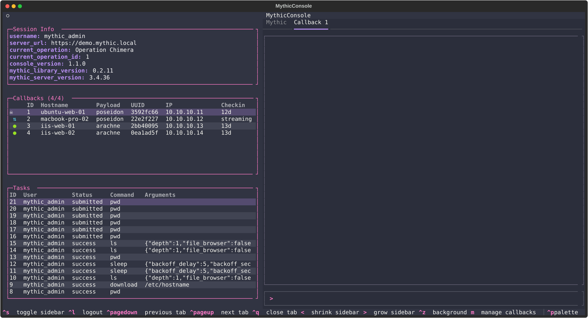

# Mythic Console

Mythic Console is a terminal user interface that can be used to interact
with [Mythic C2](https://github.com/its-a-feature/Mythic).
Mythic Console is not designed to replace the web interface but rather provide an alternate interface for
users to interact with callbacks and operations. This application was made with [Textual](https://textual.textualize.io/).

# Supported Agents

Any Mythic payload type works out of the box: Mythic Console generates its commands from the
server's own command catalog, no agent-specific code required. An agent can be enhanced further
with an installable plugin (custom commands, output rendering, scripts). See
[customize.md](customize.md).

# Demo

https://github.com/user-attachments/assets/daace4bd-f779-4984-983c-5c38b7562d8d

# Highlights

Version 1.0 is a large release. Any Mythic payload type now works out of the box: the console builds
its command set from the server's own catalog, with no agent-specific code required. It also adds a
plugin system for curation, new `payload` and `profiles` commands, an interactive payload builder,
command and file pickers, autocomplete, and live callback management.



See [What's New in 1.0](docs/whats-new-1.0.md) for more details.

# Quick Start

## Requirements

Mythic Console requires python 3.11 or greater.

## Installation

```shell
git clone https://github.com/thespicybyte/MythicConsole.git
cd MythicConsole
python -m venv venv

# linux
source venv/bin/activate

# windows
.\venv\Scripts\activate

pip install -r requirements.txt
```

## Configuration

No other configuration is required but there are a couple ways to speed up authentication.
When you start the application, the user will be prompted for the username, password, and server.
These three values may be passed in and populated for you based on environment variables or the `.env` config file.
Other variables may be passed to further configure your environment.

| Name                    | Description                                                                                         |
|-------------------------|-----------------------------------------------------------------------------------------------------|
| MYTHIC_CONSOLE_USER     | Populates the username field                                                                        |
| MYTHIC_CONSOLE_PASSWORD | Populates the password field                                                                        |
| MYTHIC_SERVER_URL       | Populates the server field                                                                          |
| DOWNLOAD_DIRECTORY      | Configures the base directory where files downloaded from Mythic are stored                         |
| LOG_DIRECTORY           | Set the  directory logs are stored in. Default is cwd                                               |
| LOG_FILE                | Set the log  file. Default is .console.log                                                          |
| LOG_LEVEL               | Set the log level. Available options are `debug`, `info`, `warning`, and `error`. Default is `info` |
| PLUGIN_DIRECTORY        | Set the directory plugins install into. Default is `${XDG_CONFIG_HOME:-~/.config}/mythicconsole/plugins` |

## Execution

```
python console.py
```

## Keyboard Shortcuts

Use `Ctrl+<` to shrink the sidebar. Use `Ctrl+>` to grow the sidebar. These work on Ghostty and
other terminals that support the Kitty keyboard protocol (for example kitty, WezTerm, and iTerm2
with the protocol enabled).

On a terminal that sends `Alt` correctly, you can also use `Alt+Left` to shrink the sidebar and
`Alt+Right` to grow it. On older terminals that support neither, the sidebar keys do nothing.

# Extend Mythic Console

Supporting a new agent needs zero code. Check out the [customization page](customize.md) to learn
how to add polish as an installable plugin: a curated command, a custom renderer, a confirmation
prompt, a client-side script, or a full hand-written agent.

# Road Map

- [ ] More curated agent plugins

