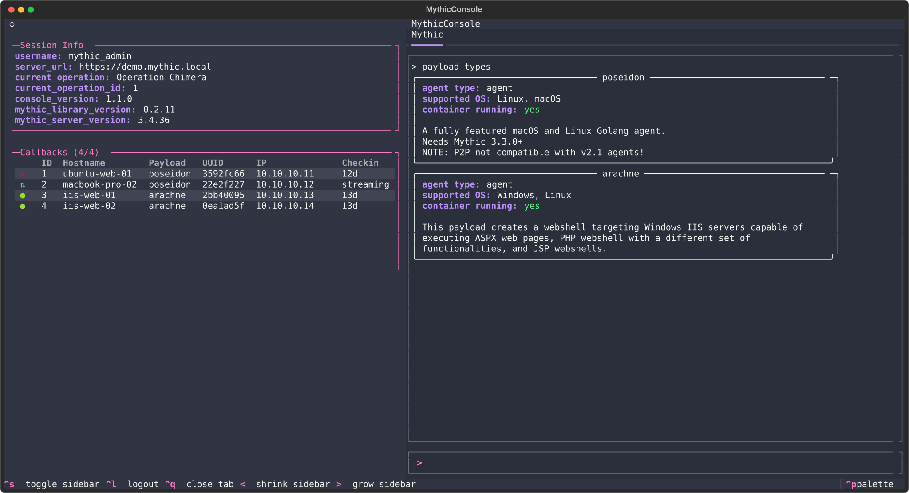
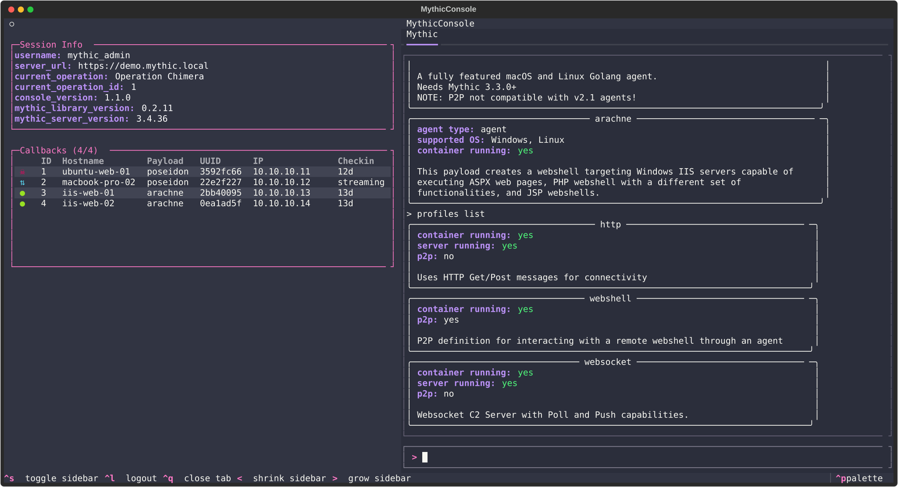
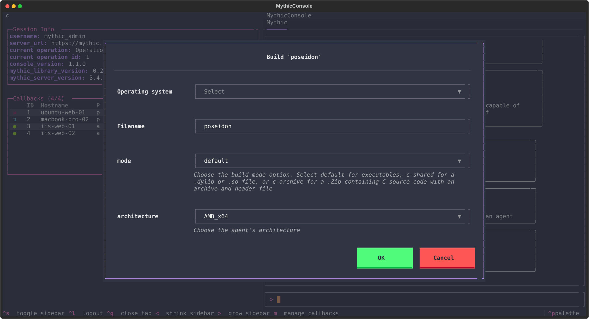
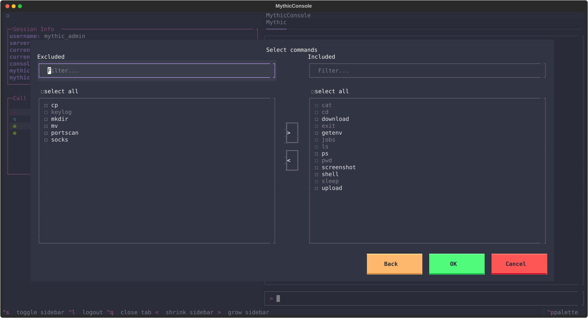
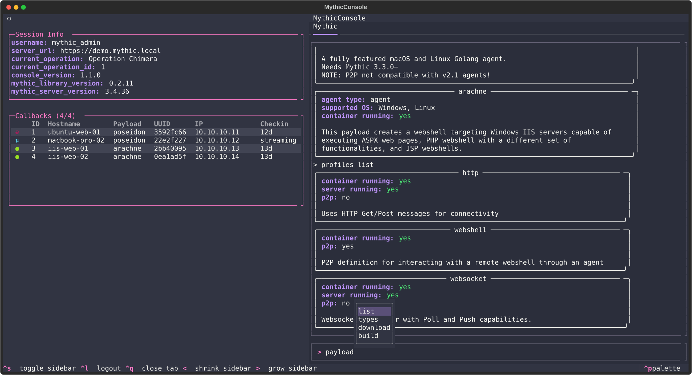
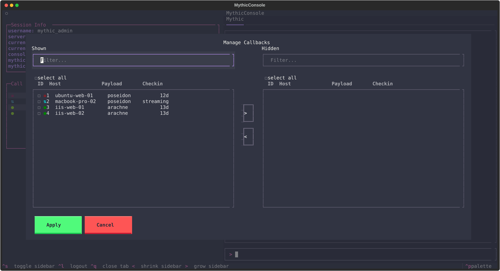
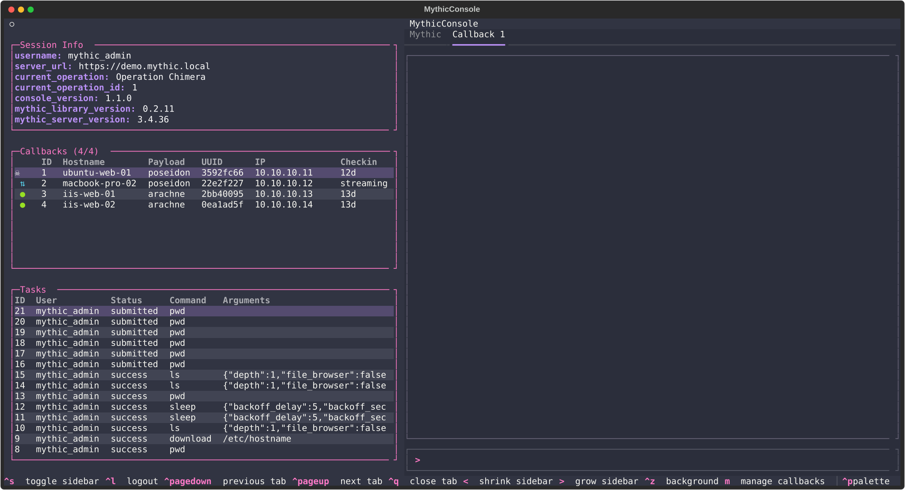
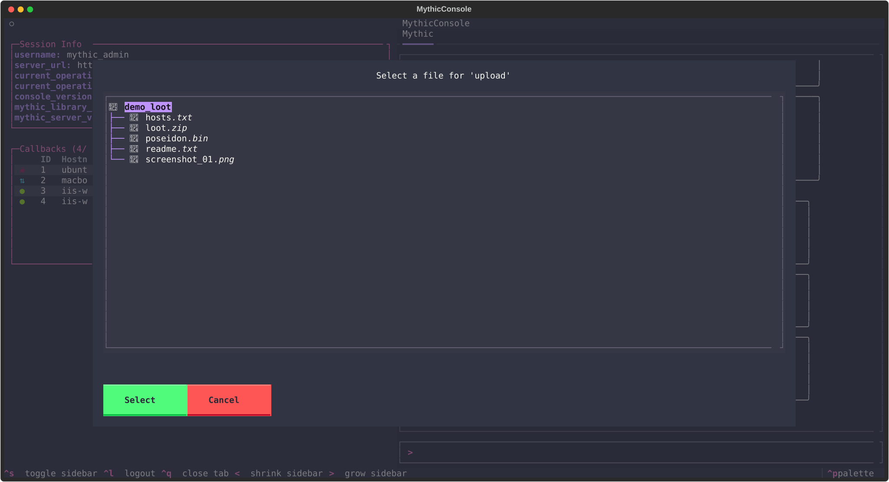

# What's New in 1.0

Mythic Console 1.0 is a large release. The headline change is that **any Mythic payload type now
works out of the box**: the console builds its command set from the server's own catalog, so no
agent-specific code is required. On top of that baseline, this release adds a plugin system for
curation, new global commands for payloads and C2 profiles, an interactive payload builder, command
and file pickers, a rebuilt console with selectable and copyable output, and quality-of-life touches
like autocomplete and live callback management.

This page is a short tour. For installation and configuration, see the [README](../README.md).

---

## Any payload type, no code required

The biggest change in 1.0 is how agents are supported. Mythic Console builds each agent's command set
directly from the payload type's command catalog on the server, so a payload type works the moment it
is installed on Mythic, with no agent-specific code in this project. The generated commands carry the
real parameter definitions from the server, including rich parameter types and dynamic choice lists.
A payload type with no curation falls back to a generic agent, so nothing is ever unsupported.

## Curate an agent with a plugin

When you want more than the generated baseline, such as a custom command, tailored output rendering, a
confirmation prompt, or a client-side script, you ship it as an installable plugin. Plugins are managed from the command line:

```shell
mythic-console install <github-url-or-path>    # install a plugin
mythic-console plugin list                     # list installed plugins
mythic-console plugin new <name> <payload>     # scaffold a new plugin
mythic-console plugin validate <path>          # validate before shipping
mythic-console plugin remove <name>            # remove a plugin
```

See [customize.md](../customize.md) for a full walkthrough.

## Payload types from the server catalog

`payload types` lists every payload type installed on the Mythic server, each rendered as a card with
its details. The console reads this straight from the server, which is the same mechanism that lets
any agent work without custom code.



## C2 profiles at a glance

`profiles list` renders each C2 profile as a card showing whether its container is running, whether
its server has been started, and whether it is a P2P profile. P2P profiles omit the server line,
because they have no C2 server to start.



## Interactive payload builder

`payload build <type>` walks you through building a payload with a series of forms: OS, filename and
build options first, then per-profile C2 parameters, command selection, and a build summary. No need
to assemble a config by hand.



## Command picker

When selecting which commands to bake into a payload, the picker presents an include/exclude transfer
view. Commands that are incompatible with the chosen OS or build parameters are greyed out, so you
only pick what will actually work. Hover over a greyed-out command to see a tooltip explaining why it
is unavailable.



## Autocomplete

The command prompt offers autocomplete. Press `Tab` to see the available subcommands for a command as
inline hints, so the full command set is discoverable without leaving the prompt.



## Manage callbacks

The Manage Callbacks modal lets you show or hide callbacks in bulk. Filter the list, use select-all,
and apply. This keeps a busy operation's sidebar focused on what matters.



You can also move a callback's configuration between files and the server: `callback export <id> [path]`
writes a callback's config to a JSON file, and `callback import <path>` loads a saved config back in.

## Tasking a callback

Selecting a callback opens it in its own tab with a tasks table and an output console, so you can
issue commands and read results per callback.



## Rebuilt console output

The console is now built on the [`textual-console`](https://pypi.org/project/textual-console/) widget
suite. The output pane renders in full color and the text is selectable with the mouse: drag to
select, double-click for a word, triple-click for a line. Press `ctrl+c` to copy the selection. The
same package also drives the command input's history and the autocomplete shown above. Your command
history persists across restarts, so it is waiting for you the next time you launch.

## Local file picker

Commands that take a local path (for example `upload`) open a file picker that browses your local
filesystem, so you can pick a file without typing out its path.


